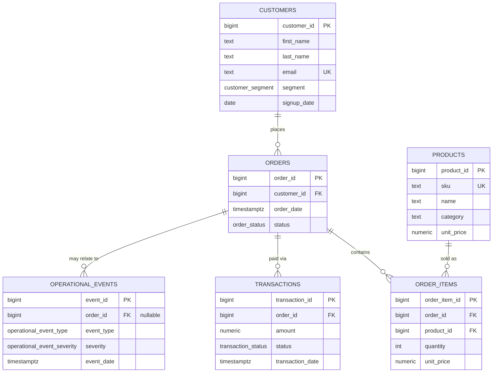

# Data Model — Northstar Commerce

Fictional e-commerce/retail dataset. See `sql/schema.sql` for the full DDL and
`PROJECT_SPEC.md` for the business scenario this schema serves.

## Entity-Relationship Diagram

## Table purposes

- **customers** — one row per buyer. `segment` (`new` / `returning` /
  `high_value`) drives ordering frequency and average order value in the
  synthetic data, and supports "which customer segment..." style questions.
- **products** — catalog with a `category` and `unit_price`. Prices vary by
  category (see `scripts/generate_data.py`).
- **orders** — one row per order, with a `status` lifecycle
  (`pending → paid → shipped → completed`, or `cancelled` / `refunded`).
  Only `paid` / `shipped` / `completed` orders count as recognized revenue.
- **order_items** — line items per order. `unit_price` is a *snapshot* of the
  product's price at the time of sale, so historical revenue never drifts if
  a product's current price later changes.
- **transactions** — payment attempts against an order. An order can have
  more than one transaction (e.g. a `declined` attempt followed by a
  `captured` one), which is why `transactions` (60k target) outnumbers
  `orders` (50k target).
- **operational_events** — logged incidents (outages, warehouse delays,
  carrier issues, inventory shortages) used to explain anomalies in the
  business metrics. Some are tied to a specific `order_id`; broader
  incidents (e.g. a platform-wide payment outage) are not tied to any single
  order (`order_id IS NULL`).

## Key business definitions

- **Revenue** = `SUM(order_items.quantity * order_items.unit_price)` for
  orders with `status IN ('paid','shipped','completed')`. See the
  `v_order_revenue` view in `sql/schema.sql`.
- **Failed transaction** = a `transactions` row with `status IN ('failed','declined')`.
- **Period comparison** = the same revenue/order metrics computed over two
  explicit date ranges and diffed.

## Known anomaly baked into the synthetic data

The generator (`scripts/generate_data.py`) deliberately injects a **5-day
payment gateway outage, April 10–14 (of the dataset's second year)**, plus an
overlapping **warehouse system migration** that slowed fulfillment for the
rest that month. During this window:

- The `failed`/`declined` transaction rate for that 5-day window rises to
  roughly **35–40%**, versus a low-single-digit baseline the rest of the
  month (verified against the generated data: 2–6% outside the window vs.
  ~35–40% inside it).
- A cluster of `payment_gateway_outage` (severity `critical`/`high`) and
  `warehouse_delay` (severity `medium`/`high`) rows appear in
  `operational_events`, dated across that window.
- Whole-month completed-order revenue for that April comes in at roughly
  **half** of the surrounding months (verified: ~$450k vs. ~$900k for both
  March and May of the same year, and vs. ~$875k for April the prior year).

This exists so that a question like *"Why did sales decrease in the second
half of April?"* has a real, discoverable, data-backed answer (join
`orders`/`transactions`/`operational_events` for that date range), rather
than the assistant having to fabricate an explanation. The exact injected
year/month is logged by the generator at run time and recorded in
`data/README.md` after generation.
